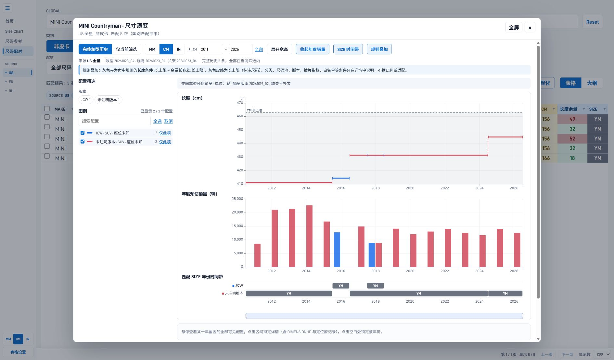
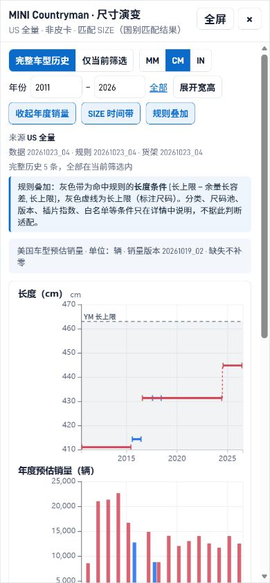

# 年度原子预估销量可视化

已于 2026-10-26 实现并更新本地 `public`。网站批次为 `2026-10-26_03_pipeline`；本轮未执行 NAS 或 GitHub 部署。

## 数据与构建

`configs/pipeline.yaml` 的 A0、A1 路径已改到正式 `nodes/` 目录，并新增 `sales_output_dir`。构建开始固定三个节点的发布物，恢复执行时复核固定文件与 manifest 的 SHA256。

`tools/build_sales_year_data.py` 读取 A0 US 全量表和 `原子销量.csv`，核对 A0 实际使用的销量 SHA256，并校验原子唯一、身份存在、年份范围与覆盖、非负有限销量，以及逐身份的年度已知值汇总守恒。全部校验通过后才写独立销量清单和按类别、MAKE 划分的分片。

当前销量版本 `20261019_02`、A0 版本 `20261023_04`，共 4,383 个尺寸身份、15,223 条年度原子、63 个分片。两个 2027 年缺失值保留为 `null`。US、HNT、TM、TM_拆分复用这些数据；EU、RU 显示无同口径数据。

前端通过 `loadModelSales(modelKeys)` 按需加载、缓存相关分片，失败后允许单独重试。按配置汇总时及计算可见配置合计时，均按 `DIMENSION-ID + ATOM_YEAR` 去重。销量图与尺寸图、SIZE 时间带共用数值年份轴、缩放、图例、筛选和年份锁定。年度文字明细列出配置销量、缺失数、原子身份和来源版本。店铺弹窗明确说明是车型市场预估销量。

构建在切换 `public` 前执行站点校验、原有尺码配对 Node 验收和新增年度销量 Node 验收。新功能维护在 `site_overrides/`，资源版本为 `20261026-1`。同时修复 A0 版本提示误读 A1 版本，以及 `Fiat`/`FIAT` 在多次构建中分片排序不稳定的问题。

```powershell
python tools/run_all.py --to-step build_public_site
python -m pytest tests -q
node --test tests/js/*.test.cjs
node tests/acceptance/sales_year_data.cjs --site public
```

## A1 补充修复

本轮经用户确认，重新生成并本地发布 A1 `20261026_02`。当前 RU 的同一亚马逊尺码 `4XL-0` 可分别对应 OZON `4XL`、`YL`，旧 A1 全局唯一映射假设会阻止构建。A1 现按完整尺码组合隔离压缩、来源分配、销量和尺寸汇总，输出保留原始尺码值。只有 RU 三份交付物发生变化，US 与店铺交付物保持原有字节；A0 业务数据与销量估算算法均未修改。

## 验收结果

- 网站 Python：150 项通过；前端 Node：50 项通过；A1：40 项通过。
- 数据验收：4,383 个身份逐 ID 与 A0 守恒，US 与三家店铺逐年销量一致，2 个缺失值保留。
- 浏览器：单车型、多配置、多车型、皮卡 CAB/BED、图例、范围、年份窗口、单位、全屏、390px 窄屏、店铺说明、EU 无数据、真实缺失、加载失败重试、压缩/全量切换、原记录定位和复制均已检查。
- 最终 `public` 与已验收沙箱的站点文件逐字节一致；仅运行日志中的时间与临时路径不同。
- 另行运行的 all_cars_data 全仓结构校验仍报告 D2.链接分析 的旧目录登记及缺少 output，与本功能无关，未修改该分析节点。

原始结果与日志见 [validation.json](../reports/2026-10-26-annual-sales/validation.json)。

桌面截图：



窄屏截图：


